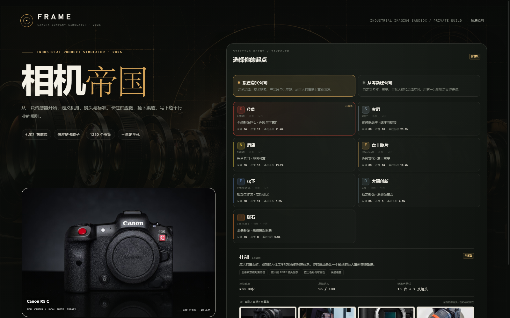
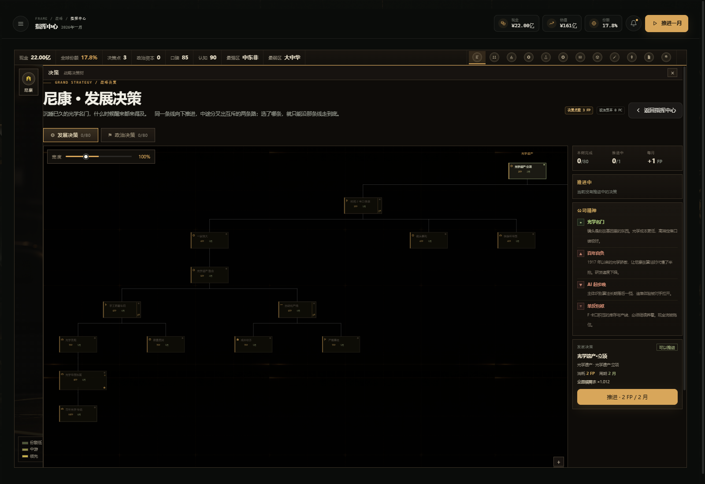
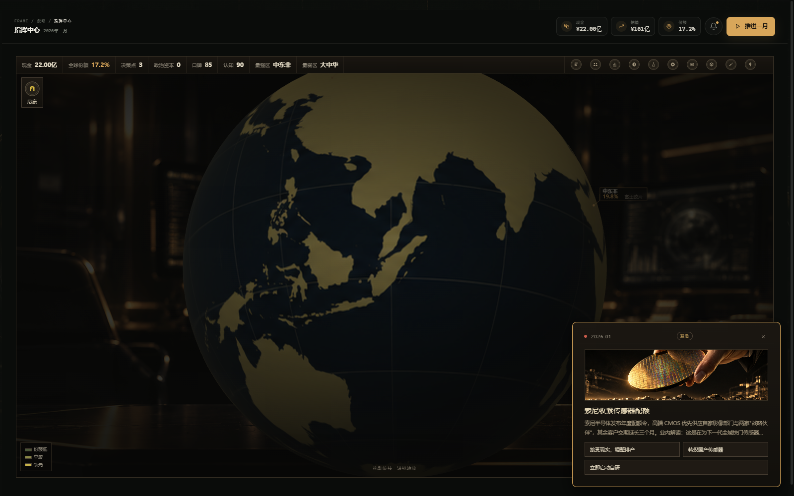
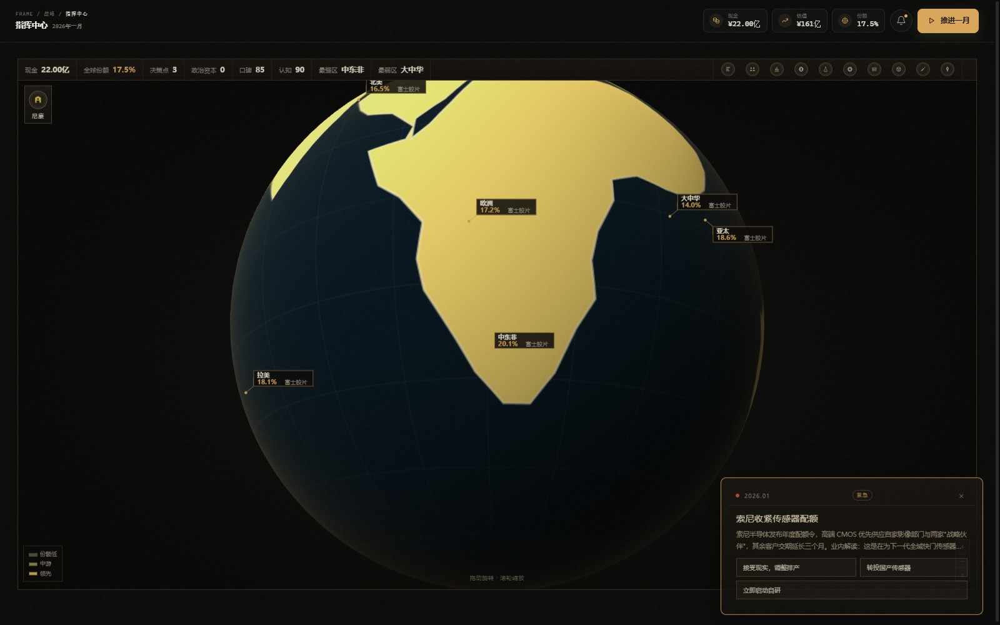

# 相机帝国 · FRAME: Camera Empire v3.0

**七家影像巨头，三十个月，一场关于传感器、卡口与标准的冷战。**

一款发生在架空 2026 年的单机相机产业沙盒。你可以接管**索尼、佳能、尼康、富士、松下、大疆、影石**七家之一，也可以从零创立自己的影像公司——然后在三十个月里，用 1280 个决策节点、断供与结盟、芯片与卡口，把它的名字写进这个行业的历史。



---

## 直接运行

> **桌面端更新提醒**：桌面版运行的是 `desktop-app\app\` 里的副本，不是根目录的 `js/`。
> 改了根目录的代码后，要么双击 `desktop-app\更新桌面端.bat`，要么运行
> `powershell -ExecutionPolicy Bypass -File tools\sync-desktop.ps1`，然后重新打开 `FRAME.exe`。

- **Windows：** 双击 `启动游戏.bat`，或直接运行 `desktop-app\FRAME.exe`（已做 2.5K / 高 DPI 适配，按 F11 切无边框全屏）。
- **任意系统：** 用 Chrome / Edge / Firefox 打开 `index.html`。

不需要安装、不需要服务器、不需要联网即可游玩。界面由原生 HTML / CSS / JavaScript 与 SVG 生成，三维地球与相机结构图用 WebGL2 手写渲染，**没有第三方依赖**。

存档保存在浏览器 `localStorage`。重要进度可在「设置与帮助 → 导出 JSON」备份。

---

## 这一版做了什么

| 模块 | 内容 |
|---|---|
| **三维地球** | WebGL 球体 + 真实海岸线贴图，份额实时着色，可拖动旋转、滚轮缩放 |
| **决策系统** | 8 家公司 × 160 个决策 = **1280 节点**，25 组互斥 / 家，8 种节点类型 |
| **新闻播报** | 世界大事全员可见，国策完成只有自己知道 |
| **事件系统** | 18 条世界事件（按月触发）+ 24 条国策触发事件，每个都有选项与真实后果 |
| **公司精神** | 4 档强弱、30+ 个精神，负面可通过决策洗掉 |
| **美术素材** | 27 张 AI 生成场景图：主视觉、地球贴图、新闻配图、结局插画、人物像 |
| **桌面端** | DPI 感知、2.5K 渲染、无边框全屏、素材同步 |

---

## 决策系统（核心）

游戏的一切都围绕这张树。



### 结构

每家公司有**两棵树**，各 80 个决策：

| 树 | 结构 |
|---|---|
| **发展决策** | 4 条业务线 × 18 节点 + 转型区 8 节点 |
| **政治决策** | 总路线 1 + 三大阵营 × 26 + 终局 1 |

每条发展线的形状：

```
[根] → ⇄互斥①（左右各 3 并行）→ [中继] → ⇄互斥②（左右各 2 并行）→ [线终局] → [传说]
```

政治树是阵营制：

```
[总路线] → ⇄三选一（铁腕 / 结盟 / 暗影）
              └ 每阵营 5 支线 ×（支线根 → ⇄强硬/温和 + 并行布局 → 支线终局）
                                    → [政治终局]
```

### 互斥

单家 **25 组互斥**，全游戏 **200+ 组**。选了一边，另一边连同它下面整条链永久灰掉，不可撤销。

UI 上有三重提示：

- 互斥节点：金色粗边框 + 中间竖缝 + 右下角 `⇄`
- 被锁死的一侧：红褐边框 + 斜线水印 + 半透明
- 连线：未选红虚线，已选金实线

### 八种节点类型

| 类型 | 标记 | 做什么 |
|---|---|---|
| 数值 | ◆ | 直接加 buff |
| 解锁机型 | ▣ | 新机型进设计工作台，由你定价发布 |
| 解锁芯片 | ⬢ | CMOS / 对焦芯片进芯片库 |
| 触发事件 | ⚑ | 完成时必弹事件与选项 |
| 外交动作 | ↔ | 解锁专属外交手段（断供、授权等） |
| 人事 | ☗ | 换人，消除或增加一个公司精神 |
| 风险 | ☠ | 掷骰：成功大赚，失败真扣钱扣研发 |
| 标准 | ◈ | 进标准委员会，长期口碑收益 |

### 前置条件

不只是“点上一个”，还会卡：

| 类型 | 示例 |
|---|---|
| 顺序 | 完成上一节点 |
| **份额** | 全画幅份额 > 12% 才能点「卡特尔之父」 |
| **现金** | 现金 > 3 亿才能点「赌上公司」 |
| **事件** | 必须先发生「反垄断调查」才能点应对 |
| **互斥** | 左右二选一，选了不可逆 |

### 节奏

- 每月 +1 决策点（FP），三十个月共 30 点
- 单家 160 节点，一局只够走 **8~10 个**
- 换句话说：**你永远会错过九成以上的树**

---

## 三维地球



- WebGL2 手写渲染：72×144 段球体网格 + 漫反射光照 + 边缘大气光
- 贴图是 4096×2048 等距圆柱投影，真实海岸线
- 六个区域的份额实时着色，标签只出现在正面半球
- 拖动旋转、滚轮缩放、右键复位

---

## 新闻播报与事件



三类播报：

| 类型 | 谁看到 | 能否操作 |
|---|---|---|
| 世界大事 | 所有人 | 有选项，会影响全局 |
| 国策完成 | 只有自己 | 纯记录 |
| 对手动向 | 情报范围内 | 可解锁反制 |

事件按两种方式触发：按月（18 条世界事件，2026.01 – 2028.06）、按决策完成（24 条公司专属事件）。

每个事件都有具体后果，不是纯文字：

> **索尼收紧传感器配额** → 接受（传感器成本 ×1.06）/ 转国产（×1.02，口碑 −0.05）/ 自研（研发 ×1.08，现金 −3 亿）

---

## 公司精神


按公司强弱分档，**强势公司只背一个包袱，弱势公司背三个**：

| 档位 | 公司 | 正面 | 负面 |
|---|---|---|---|
| 强势 | 索尼 | 传感器卡特尔 / AI 先手 / 内容生态 | 大企业病 |
| 强势 | 佳能 | 渠道之王 / 直出色彩 / 镜头群霸主 | 巨人迟缓 |
| 中上 | 大疆 / 影石 / 富士 / 松下 | 各 2 个 | 各 2 个 |
| 弱势 | 尼康 | 光学名门 | **百年自负 / AI 起步晚 / 单反包袱** |
| 弱势 | 自建 | 白纸优势 | 无名之辈 / 现金焦虑 / 无生态 |

负面可以靠决策洗掉，但要占掉一个岔口位置——代价是放弃同层的两个增益。

---

## 芯片与产品

| 页面 | 内容 |
|---|---|
| 芯片实验室 | CMOS 与对焦芯片，采购快、自研狠 |
| 产品矩阵 | 定价、备货、发布 |
| 设计工作台 | 机身、镜头、取景器、按键 |
| 参考图库 | 179 台真实机型实拍照片 |


---

## 世界地图与外交

> 说明：外交页的统计口径已改为「销量对比」，六区域份额在三维地球上展示。

- 六个区域：**大中华 / 亚太 / 欧洲 / 北美 / 拉美 / 中东非**
- 六种外交动作：垄断、切断供应、强烈竞争、结盟、制裁、技术授权
- 每个动作都有代价与反制：断供会招致联盟围剿，制裁会让对方在你最强区域反向压价

---

## 两套开局

| 模式 | 说明 |
|---|---|
| **接管真实公司** | 继承品牌、技术、产品线与供应链，但也要继承它的包袱 |
| **从零新建** | 自定义名称、定位、目标人群与品牌基因，白纸一张 |

---

## 操作

| 操作 | 说明 |
|---|---|
| 推进一月 | 顶部右侧按钮，结算本月 |
| 决策树 | 滚轮缩放，拖动平移，点击节点看详情 |
| 地球 | 拖动旋转，滚轮缩放 |
| 全屏 | 桌面端 F11 |
| 存档 | 自动保存，可导出 / 导入 JSON |

---

## 目录

```
相机公司模拟器/
├─ index.html            入口
├─ js/
│   ├─ data.js           公司、机型、区域、芯片定义
│   ├─ chipdata.js       CMOS / 对焦芯片型号库
│   ├─ engine.js         月度结算与市场模型
│   ├─ focusdata.js      1280 个决策节点
│   ├─ spirits.js        公司精神
│   ├─ focus.js          决策引擎（前置 / 互斥 / 风险）
│   ├─ events.js         事件系统
│   ├─ news.js           新闻播报
│   ├─ globe3d.js        三维地球（WebGL）
│   ├─ commandui.js      指挥中心
│   ├─ focusui.js        决策树渲染
│   ├─ strategyui.js     战略地图与外交
│   ├─ vecicons.js       矢量图标
│   └─ ui.js             页面与交互
├─ assets/art/           27 张美术素材
├─ docs/
│   ├─ story-opening.md  序章故事
│   ├─ world-bible.md    世界圣经
│   └─ promo.md          宣传物料
├─ screenshots/          实机截图
├─ desktop/              桌面端 C# 源码
├─ desktop-app/          打包好的桌面端
└─ tools/                同步与构建脚本
```

---

## 技术说明

- 纯前端，无构建、无依赖，`file://` 直接可跑
- 三维地球与相机结构示意：手写 WebGL2，无 three.js
- 决策树：纯 SVG 矢量渲染，缩放不糊
- 桌面端：WinForms + WebView2，PerMonitorV2 DPI 感知
- 所有数值修正（研发 / 成本 / 需求 / 口碑 / 份额）都真实进入月度结算，不是纯文案

---

## 说明

本作为个人自用模拟游戏，公司名与产品名用于架空叙事，产品图来自本地实拍照片库，仅供个人非商业参考。
