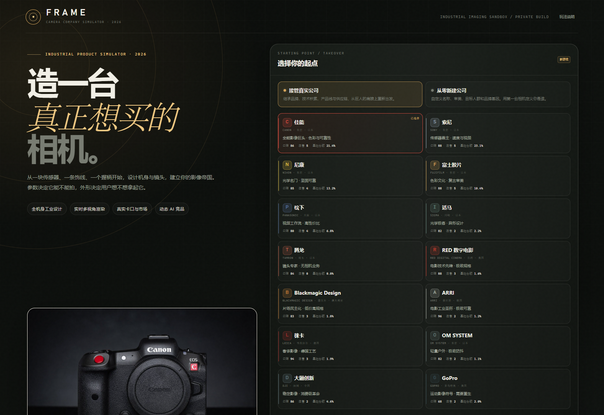
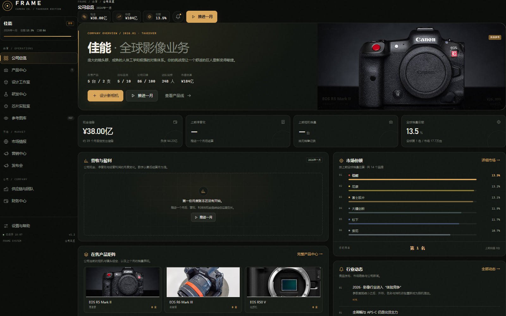
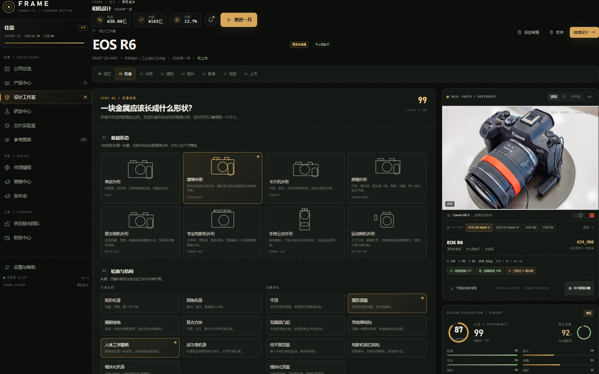
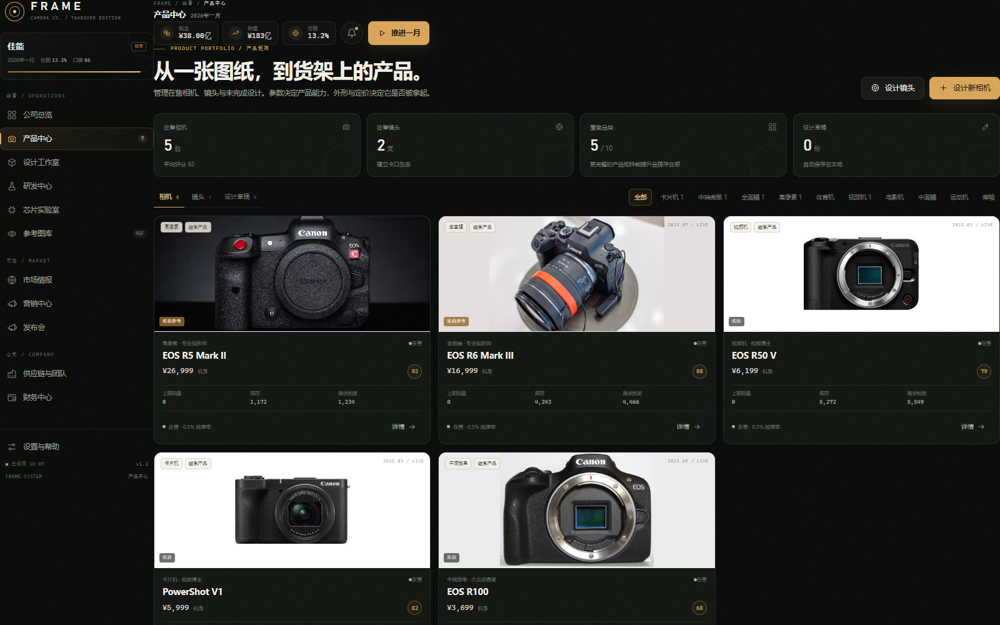
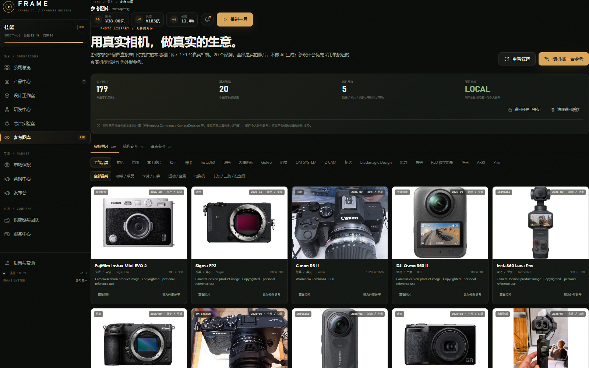
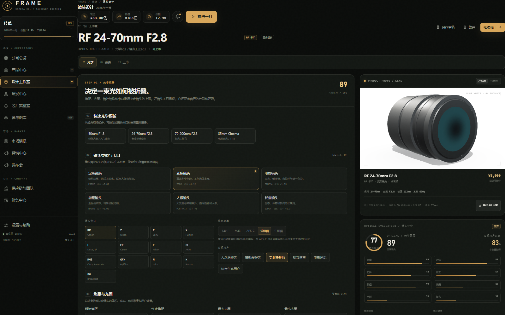
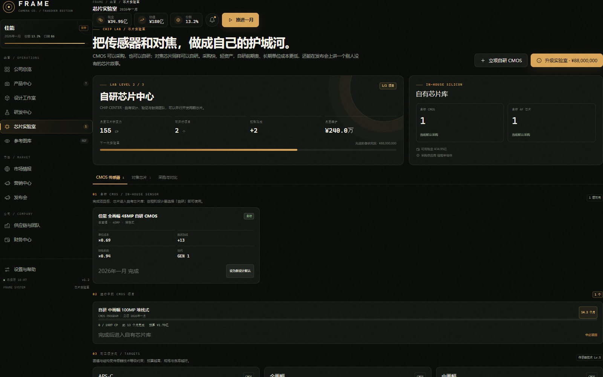
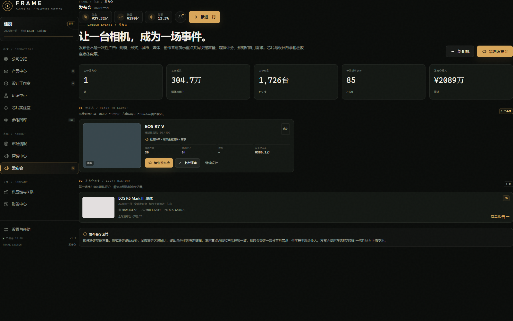

# FRAME · 相机公司模拟器 v1.2

一款发生在 2026 年的单机相机产业沙盒。你可以接管佳能、索尼、尼康、富士、松下、适马、腾龙、RED、Blackmagic Design、ARRI、徕卡、OM SYSTEM、大疆或 GoPro，也可以从零创立自己的影像公司。



## 直接运行

- **Windows：** 双击 `启动游戏.bat`。
- **任意系统：** 直接用 Chrome / Edge / Firefox 打开 `index.html`。

不需要安装、不需要服务器、不需要联网即可游玩。相机产品图直接来自本地实拍照片库；界面、结构校验、技术图与 3D 示意由原生 HTML / CSS / JavaScript、SVG 与 WebGL2 生成，没有第三方依赖。建议使用较新的 Chrome 或 Edge。

> 2026.11 新增：芯片实验室（CMOS / AF 自研、采购/自研切换）与发布会系统（规模、形式、城市、媒体、创作者、预购、报告与历史）。
>
> 2026.11 更新：接入本地实拍照片库（179 台真实相机、20 个品牌）。游戏内相机产品图直接使用这些真实照片，不再 AI 生成；新设计按「外形基准 → 参考机型 → 品类」挑选最接近的实拍图，并保留结构比例求解与 3D 结构示意。详见下方 [实拍照片库与产品图](#实拍照片库与产品图202611-更新)。

存档保存在浏览器的 `localStorage` 中。重要进度可以在「设置与帮助 → 导出 JSON」备份，并通过「导入 JSON」恢复。更换浏览器、清理浏览器数据或使用隐私模式之前，请先导出存档。

## 两套开局

- **接管真实公司：** 继承已有品牌、技术等级、产品线、卡口生态、团队和现金。每家公司有自己的起点、审美与经营压力。
- **从零新建公司：** 自定义中英文名称、品牌基因、设计语言、目标人群、启动难度与强调色，以第一台相机建立品牌。

游戏从 **2026 年 1 月** 开始，以「推进一月」进行回合结算。



## 相机工业设计

设计工作室不是一个参数表单，而是一套可实时看到结果的工业设计工具：参数和评分即时联动，右侧是当前设计对应的真实机型照片；想看几何变化时切到「3D 示意」，想看正交视图时切到「技术图」。每台相机由以下维度共同构成：

- **产品线：** 入门卡片机、中端微单、高端全画幅、高像素商业机、高速体育机、视频博主相机、专业电影机、中画幅、运动相机、复古旁轴。
- **机身造型：** 8 种基础形态、7 种轮廓、7 种顶部结构、6 种前脸；宽 / 高 / 深、握柄高度 / 深度 / 弧度、镜头卡口比例均可调整。
- **材质与表面：** 金属、镁合金、钛、工程塑料、碳纤维等，配合磨砂、拉丝、阳极氧化、皮革、烤漆等表面处理与中框 / 顶盖结构。
- **颜色系统：** 机身、顶盖、握柄、饰线、品牌强调色、铭牌、按键、拨轮、镜头环可独立设色；支持双色机身与限量配色。
- **控制布局：** 快门、录制、播放、菜单、FN、C1 / C2 / C3 的位置；前 / 后 / 模式 / 第三拨轮；摇杆与位置；触控区域；四种系统界面语言。
- **屏幕与取景器：** 固定、侧翻、上翻、下翻、折叠、无屏；尺寸、边框、分辨率、亮度、色域、刷新率、触控；无取景器、小型、专业、眼平、腰平、折叠取景器，位置可调。
- **卡口与配件：** RF、Z、E、F、X、L、EF、PL、M43、GFX、M、B4、固定卡口；卡口环材质与颜色；电池手柄、竖拍手柄、麦克风、监视器、风扇、兔笼、肩扛套件、无线图传、闪光灯及各自的造型变体。
- **实时外观评分：** 颜值、复古感、专业感、便携性、握持感、商务感、潮流感、电影机气质、消费级气质、目标审美匹配度，同时给出成本、重量、机身三围、故障率与建议定价。
- **四视图与线稿：** 正面、背面、顶部、侧面实时工业渲染；可切换尺寸标注与线稿模式。所有技术图形来自设计数据，而不是固定模板贴图；商品图则使用实拍照片。



## 实拍照片库与产品图（2026.11 更新）

游戏内的相机产品图不再使用 AI 生成，也不再用程序化渲染去猜外形；它们直接来自你提供的本地实拍照片库。照片保持原样，只做了尺寸压缩，不修改机身、不重绘、不拼接。当前库覆盖 **179 台真实相机、20 个品牌、5 个品类**。

### 1. 本地照片库（`js/photodata.js` + `assets/photos/`）

- 原始照片仍保留在 `照片库/`（按「品类 / 品牌」归档，附 `manifest.csv` 与网页相册）；游戏使用 `assets/photos/` 中的网页副本：最长边 1400px、JPEG，共约 18.5MB，不含任何生成图。
- 每张照片记录品牌、机型、发布日期、品类、来源、授权、作者、原始分辨率、边缘背景色和适配方式，显示在产品详情与照片详情里。
- 匹配顺序：**品牌 + 机型精确匹配 → 归一化匹配（Mark/II、α/A、EOS/Lumix 等）→ 同品牌同品类 → 同品牌最近机型**。
- 对于少数本身不是产品图的照片（开箱、货架、机架、屏幕背面、手持场景），产品页会改用同品牌可用的干净实拍图，并在图卡上标注「实拍参考」、在详情里注明实际照片机型；原始照片仍完整保留在照片库中，点击即可查看。
- 已被替换的典型：EOS R5 Mark II 开箱图、FX3 头盔场景、Zf 货架、GFX100 II 手持、Sigma BF 屏幕背面、PYXIS 6K 机架、HERO13 道路视角等。

### 2. 产品图出现在哪里

产品中心卡片、产品详情、公司总览 hero、在售产品矩阵、上市确认 / 成功页、设计工作台的形象预览全部使用实拍图。每张图带「实拍」或「实拍参考」角标；详情页底部显示照片来源、授权与作者。照片只做等比缩放和容器裁切，不做调色、换色或合成。



### 3. 新相机怎样参考真实照片

- 设计工作台默认显示当前设计最接近的真实机型照片：优先使用「外形基准」机型，其次参考机型，最后按品类挑选；如果玩家在图库中手动指定过照片，则优先使用指定照片。
- 图库照片详情里的「设为外形参考」会把照片写入当前设计草稿；如果该照片在结构库中有对应机型，还会同时套用它的宽高、握柄、取景器比例。
- 照片是外形与配色参考，不会因为拖动滑杆而重绘。需要看参数变化后的几何时，切到「3D 示意」；需要看正交视图与尺寸时，切到「技术图」。
- 自建品牌没有自己的实拍图，会使用同品类参考机型的照片，并在界面上明确标注「实拍参考 / 跨品牌实拍参考」，不会把别人的照片冒充成自研产品。

### 4. 照片库页面



左侧导航「参考图库」默认打开 **实拍照片** 视图：

- 按品牌 / 品类筛选，浏览全部 179 张照片；卡片显示机型、日期、分辨率、来源与授权。
- 点开照片可看大图、完整元数据与结构库匹配情况，并可「设为外形参考」或「下载照片」。
- 「结构参考」保留 79 台真实机身的宽高、握柄、顶盖、卡口等比例档案；「镜头参考」保留 24 支镜头的结构档案。结构卡片也会优先显示本地实拍图。
- 联网补充是**可选**的，默认关闭；本地照片不依赖网络。开启后可从 Wikimedia Commons 补充本地库没有的缩略图，并缓存到 IndexedDB（浏览器禁用时退回内存）。

### 5. 保留的结构与 3D 工具

- **Reality Guard 比例求解器**（`js/artlib.js`）仍然存在：品牌接管时套用该品牌经典机型的比例；自建公司时套用同品类参考中位数；输出 7 项结构校验、品牌贴合度与「一键校正比例」。
- **程序化 3D 渲染器**（`js/art3d.js`）保留为设计工作台的「3D 示意」和 4K 结构图导出工具，并在界面上明确标注「3D STUDY / 仅结构示意」，不再作为商品图。
- **技术图**保留原来的四视图、尺寸标注、线稿模式。
- 镜头产品图仍使用 3D 结构示意：你提供的照片库是相机机身照片，没有独立镜头照片；如果后续补充镜头照片，可在 `照片库` 中按同一结构加入并在图库中替换。

### 6. 版权与使用范围

这是个人自用的非商业模拟游戏。照片来自你提供的本地参考库（Wikimedia Commons、CameraDecision 等，授权信息逐张记录），仅用于外形参考与个人游玩；游戏不修改原图、不把原图嵌入生成图、不对外分发照片。照片版权归原作者 / 来源网站所有。若要公开分发，请只分发 `assets/photos` 中你拥有授权的照片，或移除该目录并改用内置结构数据。


## 镜头设计

镜头有独立的三步工作台：

1. 光学基础：定焦 / 变焦 / 电影 / 微距 / 人像 / 长焦，焦距、光圈、画幅覆盖、卡口、镜片数量、非球面 / 低色散 / 萤石、镀膜与对焦马达。
2. 镜身外观：七种镜身语言（专业黑、复古银、红圈、金圈、蓝圈、白色长焦炮、电影工业），材质、表面、对焦环、光圈环、齿轮环、全天候、防抖。
3. 上市：成本、定价、首批库存、品控、营销和卡口生态评估。

镜头预览支持外观与剖面视图。剖面会按光学数据结构绘制镜片组与光路示意。



## 芯片自研（CMOS / AF）

相机不只是组装：传感器和对焦芯片决定了成本、画质、追焦和发布会上的技术叙事。这一版新增了独立的芯片实验室。

- **CMOS 可以采购，也可以自研。** 采购走现有传感器供应商体系，单位成本由供应商报价决定；自研需要在芯片实验室立项，选择画幅（APS-C / 全画幅 / 中画幅）、像素、结构（CMOS / 背照式 / 堆栈式 / 全局快门）和预算（精益 / 均衡 / 不计成本），投入流片、验证与良率爬坡。
- **AF 芯片同样可以自研。** 选择相位检测 / 全像素 / AI 追焦架构与标准 / 进阶 / 旗舰等级，完成后给相机提供额外对焦加成，并降低对焦模组成本。
- **芯片实验室**有 4 个等级（合作流片 → 联合实验室 → 自研芯片中心 → 先进影像研究院），决定并行项目数、规格加成与月度维护；芯片项目与 13 条技术树分开推进，不占用实验室的 3 个技术项目槽位。
- **自有芯片库**：完成的 CMOS / AF 芯片会永久入库，按世代记录单位成本、画质加成、缺陷系数或对焦加成。芯片页面可以把某颗芯片设为“新设计默认”。
- **设计工作台 → 影像核心 → 芯片方案**：
  - CMOS 选择「采购」或「自研」；自研需要传感器规格与芯片匹配，也可以点「采用该芯片规格」一键对齐画幅/像素/结构。
  - AF 选择「采购模组」或「自研 AF 芯片」；自研会直接把对焦加成与成本变化计入整机。
  - 芯片选择会真实改变单位成本、画质评分、对焦评分、缺陷率与发布会叙事。
- **采购 vs 自研**：采购快、轻资产、适合现金流紧张；自研前期投入高（数千万到上亿），但长期单位成本更低、规格更可控，还能在发布会上讲“自研芯片”的故事。



## 发布会系统

发布会把一台相机变成一场事件。它不是一次性广告，而是决定首发声量、媒体评分、预购与首月需求的一套组合。

- **发布会页面**（左侧导航「发布会」）：
  - 待发布草稿：显示当前发布会方案、预计声量、媒体评分、预购与成本，可直接「策划发布会」或进入「上市评审」。
  - 发布会历史：记录每场发布会的规模、形式、媒体评分、触达、预购、投入与报告。
- **策划发布会**可选择：
  - 发布规模：静默上市 / 社交种草 / 创作者计划 / 全球发布会 / 影像文化事件。
  - 形式：线上直播 / 城市主题演讲 / 媒体上手体验 / 影像文化节。
  - 城市：线上 / 上海 / 东京 / 纽约 / 伦敦；品牌母国/区域城市有主场加成。
  - 媒体：不邀请 / 核心影像媒体 / 全球科技媒体 / 全媒体 + 大众。
  - 创作者：不邀请 / 垂类创作者 / 头部创作者 / 跨圈层顶流。
  - 演示重点：画质与传感器 / 对焦与速度 / 视频与电影感 / 设计与工艺 / 价格与普及；与产品实际强项匹配时效果更好。
  - 是否开放预购：预购会锁定一部分首月需求，但不是现金收入。
- **实时估算**：发布会成本、预计声量、媒体触达、媒体评分、预购转化、演示匹配度、首月需求与上市总投入；自研芯片会带来额外的芯片叙事加成。
- **上市后**：发布会费用计入上市支出；产品记录 `launchEvent`，首月销售会把预购计入需求；「上市完成」弹窗和「发布会历史」都会给出报告，包括媒体评分、触达、预购、声量与方案摘要。
- **与旧系统兼容**：没有配置发布会时按静默上市处理；旧存档会自动补齐默认发布会方案。



## 经营系统

- **技术研发：** 传感器、高帧率视频、自动对焦、防抖、色彩科学、编码、散热、电源、屏幕、镜头光学、机身材料、模块化、图像处理共 13 条技术树。研发需要现金和月份，完成后永久抬高产品参数上限。
- **供应链与制造：** 选择代工伙伴或自有工厂，比较产能、成本、品控、月费和升级费用；监控产能、库存、缺货和现金流。
- **团队：** 工程师、工业设计师、品控、市场、销售五类岗位，影响研发速度、外形完成度、故障率、营销效率和需求转化。
- **营销：** 月度品牌广告预算 + 一次性品牌战役（社交、创作者、体育、影像文化展、口碑修复），同时影响认知、口碑和销量。
- **财务：** 渠道分成、COGS、工资、固定运营、营销、代工费、工厂维护、保修、利息与 25% 所得税；银行贷款、授信额度、负债、估值与月度历史。
- **上市流程：** 定价、备货、品控等级、认证方案（标准 / 全球 / 加急）、上市营销、成本结构、竞品价格带和上市评审。现金不足或技术不达标会阻止上市。
- **产品生命周期：** 上市后仍可改价、选择套机镜头、转自动 / 手动生产、停产或重新上架。
- **市场与 AI 竞品：** 2026 年真实品牌产品档案、动态 AI 新品发布、降价、市场事件、供需压力、15 个品牌的市场份额和按品类需求。真实品牌名称仅用于模拟语境。
- **月度结算：** 需求预测、产能与库存、渠道费、成本、团队、营销、保修、税费、现金变化、口碑和新闻，并保存月度经营简报。
- **里程碑：** 第一台相机、第一支镜头、月销破万、十亿现金、完整矩阵、技术纵深等。

## 操作

- 侧边栏切换：公司总览 / 产品中心 / 设计工作室 / 研发中心 / 芯片实验室 / 参考图库 / 市场情报 / 营销中心 / 发布会 / 供应链与团队 / 财务中心 / 设置与帮助。
- 右上角「推进一月」完成月度结算。
- `Esc` 关闭弹窗或移动端侧边栏。
- 设计预览支持「实拍 / 3D 示意 / 技术图」切换；实拍模式可换视角、看参考照片，3D 模式可看几何变化与参考叠影，技术图保留尺寸标注和线稿。
- 设计工作台与产品详情可以下载实拍参考图；「3D 示意」可导出 4K 结构图。参考图库支持按品牌/品类筛选、查看照片来源与授权、一键套用外形参考。
- 芯片实验室：CMOS / AF 自研立项、实验室升级、芯片库与默认芯片策略；设计工作台里可逐台切换采购/自研。
- 发布会：在「发布会」页或上市步骤策划规模、形式、城市、媒体、创作者、演示重点与预购，上市后查看媒体与预购报告。
- 所有修改自动保存；也可在设置页手动保存、导出或导入存档。

## 存档

- 存储键：`frame.camera.company.save.v1`
- 存档版本：`1`
- 支持 JSON 导出 / 导入；导入前会显示确认提示。
- 游戏状态包含产品、设计草稿、财务、研发、员工、AI 竞品、芯片项目与芯片库、发布会历史、新闻、里程碑与设置。

## 目录

```text
camera-tycoon-2026/
├─ index.html            入口
├─ 启动游戏.bat          Windows 启动器
├─ README.md
├─ DEPLOY.md
├─ assets/
│  └─ photos/            实拍照片网页副本（179 张，约 18.5MB，最长边 1400px）
├─ css/
│  ├─ style.css          整套界面与响应式样式
│  └─ art.css            参考图库与产品/照片相关样式
├─ js/
│  ├─ data.js            品牌、产品线、材料、技术、市场事件等静态数据
│  ├─ engine.js          设计评估、经济、月度结算、AI 竞品、芯片项目、发布会、存档
│  ├─ artdata.js         真实相机/镜头结构档案、品牌 DNA、品类参考集
│  ├─ artlib.js          结构比例求解、参考拟合、联网补充、IndexedDB 缓存
│  ├─ art3d.js           WebGL2 / Canvas2D 程序化渲染器（3D 结构示意）
│  ├─ photodata.js       实拍照片清单：品牌、机型、日期、来源、授权、分辨率
│  ├─ photolib.js        实拍照片匹配：品牌+机型 → 品类回退 → 替代图
│  ├─ preview.js         相机与镜头的 SVG 技术图渲染（四视图/线稿保留）
│  └─ ui.js              启动页、全部页面、设计工作台、图库、芯片实验室、发布会、弹窗与交互
├─ tools/
│  └─ build_photos.py    从 照片库/manifest.csv 重建 assets/photos 与 photodata.js
└─ screenshots/          README 截图
```

## 技术说明

- 无第三方依赖、无构建步骤；本地实拍照片离线可用，联网补充是可选的增强能力。
- 使用经典脚本（非 ES Module），因此可以直接通过 `file://` 运行。
- 相机产品图直接使用 `assets/photos` 中的实拍照片；技术图与线稿由设计数据实时生成 SVG；3D 示意由 WebGL2 程序化几何实时渲染。
- 实拍照片是本地文件，不依赖 IndexedDB；只有可选的联网补充图使用 IndexedDB，不可用时退回内存缓存。
- 芯片项目按“芯片研发力 CP”逐月推进；发布会、预购、芯片与报告状态都写入存档，旧存档会自动补齐字段。
- 推荐 Chrome / Edge 等现代浏览器；3D 示意需要 WebGL2，集成显卡即可；照片页面不需要 WebGL。
- 桌面端优先，同时提供移动端布局和底部快捷启动条。

## 说明

这是一个个人自用的非商业模拟游戏。游戏内使用真实品牌、产品与卡口名称，仅用于模拟和学习语境，不代表任何品牌的官方信息。所有市场份额、价格、财务、用户评价和参数均为玩法化虚构数值，不构成购买或投资建议。

相机照片来自用户提供的本地照片库，版权归原作者 / 来源网站所有，仅作个人参考；镜头产品图仍为 3D 结构示意（照片库没有独立镜头照片）。

FRAME / CAMERA COMPANY SIMULATOR · 2026
